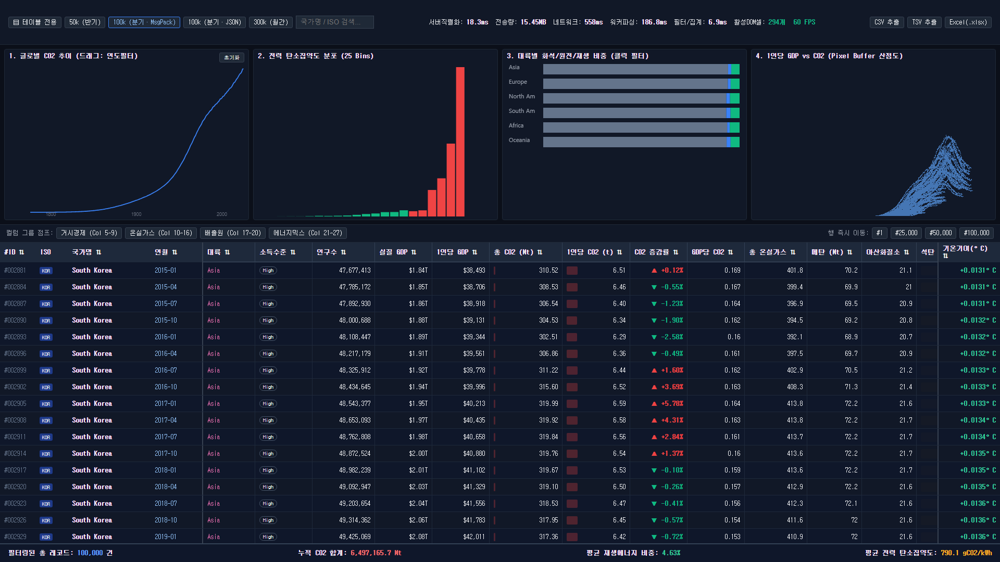
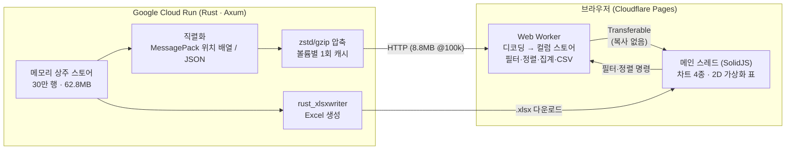
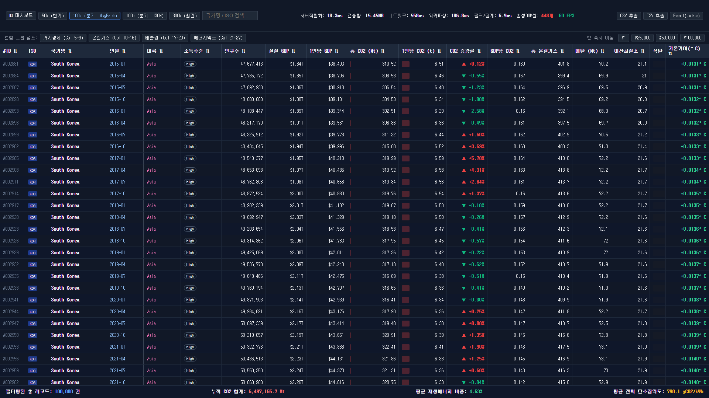

# bench-100k — Rust 고속 서버 × 대용량 기후·에너지 데이터 실시간 시각화

> **30만 행 × 28열(840만 셀)** 데이터를 Rust 서버가 수십 ms 안에 직렬화하고,
> 브라우저는 **메인 스레드를 한 번도 50ms 이상 막지 않고** 차트 4종과 2차원 가상화 테이블을 **60 FPS**로 출력하는 벤치마크 서비스입니다.

**🔗 라이브 데모: https://bench-100k.pages.dev** · 테이블 전용 화면: https://bench-100k.pages.dev/#table
**API:** `https://bench-backend-638796356878.us-west1.run.app` (Google Cloud Run, us-west1)



## 목차

1. [프로젝트 목적](#1-프로젝트-목적)
2. [핵심 장점](#2-핵심-장점)
3. [기술 선정과 이유](#3-기술-선정과-이유)
4. [사용한 데이터](#4-사용한-데이터)
5. [시스템 설계](#5-시스템-설계)
6. [기능](#6-기능)
7. [페이지별 역할](#7-페이지별-역할)
8. [속도 (실측)](#8-속도-실측)
9. [병목을 찾아 설계를 고친 과정](#9-병목을-찾아-설계를-고친-과정)
10. [API](#10-api)
11. [실행 및 배포](#11-실행-및-배포)
12. [디렉터리 구조](#12-디렉터리-구조)
13. [한계와 다음 단계](#13-한계와-다음-단계)

---

## 1. 프로젝트 목적

**"가장 빠른 축에 드는 서버 언어"와 "그 속도를 화면까지 손실 없이 전달하는 프론트엔드 구조"를 직접 골라 조합하고, 실측 수치로 증명**하는 것이 목표입니다.

대용량 데이터 서비스에서 서버만 빠르다고 끝나지 않습니다. 10만~30만 건을 받으면 병목은 다음 구간으로 옮겨 갑니다.

```
서버 직렬화 → 압축 → 네트워크 전송 → 브라우저 디코딩 → 스레드 간 복사 → DOM 렌더링
```

이 프로젝트는 이 **모든 구간의 시간을 화면 상단에 실시간으로 계측**하고, 측정으로 병목을 찾아 설계를 고친 과정까지 기록합니다. 결과물은 다음 능력을 보여줍니다.

- 서버 언어·프레임워크·전송 포맷·프론트엔드 구조를 **성능 근거로 선택**하는 능력
- 추측이 아니라 **구간별 실측으로 병목을 찾고 개선**하는 능력 ([9장](#9-병목을-찾아-설계를-고친-과정))
- 무료 클라우드 사양(512MB RAM)에 맞춘 **메모리·CPU 예산 설계**와 실제 배포

## 2. 핵심 장점

| 장점 | 내용 |
|---|---|
| **화면이 멈추지 않음** | 30만 행을 받는 동안에도 메인 스레드 Long Task(50ms 이상 차단) **0건**. 디코딩·필터·정렬·집계·CSV 생성을 모두 Web Worker에서 처리 |
| **복사 없는 데이터 전달** | 워커가 데이터를 컬럼별 TypedArray로 만들어 **Transferable(소유권 이전)** 으로 넘김. 30만 개 객체를 복사하던 0.6~0.7초 멈춤을 제거 |
| **DOM 최소화** | 840만 셀 중 실제 DOM에 있는 셀은 대시보드 기준 **266~315개**. 행·열 2차원 가상화 |
| **가벼운 서버** | 30만 행 상주 메모리 **62.8MB**, 서버 바이너리 3.4MB, 컨테이너 이미지 **6MB** |
| **빠른 응답** | 데이터가 고정이라 압축 결과를 캐시. 캐시 적중 시 서버 처리 수십 ms |
| **차트-표 교차 필터** | 차트 드래그·클릭, 검색, 정렬이 표·요약·다른 차트에 즉시 반영 (300k 기준 필터+집계 22ms) |
| **즉시 파일 추출** | CSV/TSV는 브라우저 워커에서, Excel은 Rust 서버에서 생성 |
| **무료 인프라** | Cloud Run(요청 없으면 0대) + Cloudflare Pages |

## 3. 기술 선정과 이유

| 영역 | 선택 | 이유 |
|---|---|---|
| 서버 언어 | **Rust** | 네이티브 컴파일, GC 없음. 응답 지연이 일정하고 메모리가 예측 가능. 웹 프레임워크 벤치마크(TechEmpower 등)에서 최상위권 생태계 |
| 서버 프레임워크 | **Axum 0.7 + Tokio** | hyper 기반 비동기 서버. 무거운 직렬화·압축·엑셀 생성은 `spawn_blocking`으로 분리해 `/health` 같은 다른 요청이 막히지 않음 |
| 직렬화 | **MessagePack (rmp-serde)** vs JSON | 바이너리 포맷 성능 비교. 행을 **필드명 없는 배열**로 보내 크기·디코딩 시간 절감 |
| 압축 | **zstd / gzip** (zstd·flate2) + tower-http | 브라우저가 지원하는 방식으로 자동 선택, 결과는 캐시 |
| 엑셀 | **rust_xlsxwriter** | 파일 I/O 없이 메모리 버퍼로 `.xlsx` 생성 |
| 프론트엔드 | **SolidJS** | Virtual DOM 없는 세밀한(fine-grained) 반응성. 스크롤 시 바뀐 셀만 갱신. 앱 번들 **24.9KB (gzip)** |
| 가상화 | **@tanstack/solid-virtual** | 행 + 열 2차원 가상화, 좌측 4열·우측 1열 고정 |
| 연산 | **Web Worker + TypedArray** | 무거운 연산을 모두 백그라운드 스레드로 |
| 차트 | **Canvas 2D / ImageData** | SVG 노드 0개. 산점도는 픽셀 버퍼에 직접 기록 |
| 백엔드 배포 | **Google Cloud Run** (us-west1, 512MiB, 1 vCPU, 인스턴스 0~1대) | 6MB 이미지라 콜드스타트가 짧고, 요청이 없으면 0대로 줄어 무료 한도 안에서 운영. 원래 계획한 Koyeb는 Mistral 인수 후 신규 무료 플랜이 막혀 변경 |
| 프론트 배포 | **Cloudflare Pages** | 정적 파일 전 세계 CDN 배포, 무료 |

## 4. 사용한 데이터

### 4.1 출처와 성격
- **스키마:** [Our World in Data](https://github.com/owid)의 `co2-data` + `energy-data`에서 분석 가치가 높은 **28개 컬럼**을 골라 하나의 와이드 테이블로 정의했습니다.
- **값:** 현재는 실측 CSV가 아니라 **OWID 스키마를 따르는 결정적(deterministic) 합성 데이터**입니다. 실제 100개국의 대륙·소득그룹·2024년 인구 규모를 기준으로, 국가별 산업화 시점·GDP 성장률·배출 곡선·에너지 믹스 전환을 모델링했습니다. 같은 서버는 항상 같은 값을 만듭니다.
- 실제 OWID CSV 연동은 다음 단계입니다(`backend/src/store.rs`의 `annual_base`만 교체하면 됨).

### 4.2 볼륨
100개국 × 250년(1775–2024) = 연간 25,000점 → **월 단위 선형 보간으로 300,000행**.

| 버튼 | 행 수 | 기간 단위 | 방식 |
|---|---|---|---|
| 50k (반기) | 50,000 | 1월·7월 | 같은 메모리에서 6칸 간격 선택 |
| 100k (분기) | 100,000 | 1·4·7·10월 | 3칸 간격 선택 |
| 300k (월간) | 300,000 | 매월 | 전체 |

추가 사본 없이 하나의 30만 행 배열에서 간격만 바꿔 고릅니다.

### 4.3 28개 컬럼

| 그룹 | 컬럼 | 표 표시 방식 |
|---|---|---|
| 식별자 (좌측 고정) | `record_id`, `iso_code`, `country`, `period_str` | ID 고정폭 번호, ISO 배지, 굵은 국가명(말줄임), 연-월 |
| 거시경제 | `continent`, `income_group`, `population`, `gdp`, `gdp_per_capita` | 대륙별 색상 태그, 소득 배지, 천 단위 콤마, `$1.85T` 같은 통화 약어 |
| 온실가스 | `co2`, `co2_per_capita`, `co2_growth_prct`, `co2_per_gdp`, `total_ghg`, `methane`, `nitrous_oxide` | CO₂는 셀 안 적색 막대, 증감률은 `▲ +3.42%` / `▼ -1.85%` |
| 배출원 | `coal_co2`, `oil_co2`, `gas_co2`, `cement_co2` | 석탄·석유·가스는 값에 비례한 배경 농도(히트맵) |
| 에너지 믹스 | `primary_energy_twh`, `energy_per_capita`, `renewables_share`, `fossil_share`, `nuclear_share`, `solar_wind_twh` | 비중 3종은 셀 안 게이지(재생 녹색, 화석 회색, 원자력 청색) |
| 기후 영향 | `carbon_intensity`, `temp_change_ghg` (우측 고정) | 탄소집약도 경고색(300g 초과 황색, 600g 초과 적색), 기온 기여도 배지 |

## 5. 시스템 설계

### 5.1 전체 구조



### 5.2 데이터 흐름 (첫 로드)

1. 메인 스레드가 워커에 `FETCH_AND_LOAD` 메시지를 보냅니다.
2. 워커가 API를 직접 호출합니다. 응답은 서버 캐시에서 바로 나갑니다.
3. 워커가 MessagePack을 디코딩합니다. 행은 28개 값의 배열이고, 순서는 Rust 구조체 필드 순서입니다.
4. 워커가 **컬럼 스토어**로 변환합니다.
   - 숫자 23개 컬럼: `Float32Array` / `Float64Array` / `Uint32Array`
   - 문자열 5개 컬럼: 사전 인코딩(`Uint16Array` 번호 + 고유 문자열 목록)
   - 행당 약 114바이트
5. 워커가 필터·차트 4종 집계·요약을 **배열 1회 순회**로 동시에 계산합니다.
6. 컬럼 버퍼, 필터 결과 인덱스, 차트 버퍼를 **Transferable**로 메인 스레드에 넘깁니다(복사 없음).
7. 메인 스레드는 화면에 보이는 30여 행만 그때그때 객체로 조립해 그립니다.

이후 필터·정렬은 `APPLY_FILTER` 메시지로 워커가 다시 계산하고, 인덱스와 차트 버퍼만 돌려받습니다.

### 5.3 백엔드 설계 포인트

| 설계 | 이유 / 효과 |
|---|---|
| `LazyLock<Vec<ClimateRecord>>` 메모리 상주, 서버 시작 시 1회 생성 | 요청마다 데이터 생성·조회 없음 |
| 국가명 등 반복 문자열을 `&'static str`로 공유(interning) | 행마다 힙 할당이 없음. 30만 행 62.8MB (`String`이면 약 90MB로 추정) |
| (국가, 연, 월) 순서 저장 + `step_by` 간격 선택 | 50k/100k/300k를 사본 없이 제공 |
| MessagePack **위치 배열**(`rmp_serde::to_vec`) | 필드명 반복 제거. 크기 2.3배↓, 디코딩 약 4배↑ |
| 압축 결과 캐시 (`OnceLock`, 볼륨 × 포맷 × 인코딩 최대 12개) | 0.1 vCPU에서 100k 3.3초 걸리던 압축을 1회로 |
| 기본 화면용 100k는 서버를 열기 **전에** 미리 압축 | Cloud Run은 요청 처리 중에만 CPU를 주므로, 열고 나서 백그라운드로 하면 CPU를 못 받음 |
| 무거운 요청 동시 2개 제한(Semaphore), JSON 최대 100k, 행 수는 3종으로 고정 | 공개 API에서 512MB 초과(OOM) 방지, 캐시 크기 상한 |
| `spawn_blocking` | CPU 작업이 비동기 워커를 막지 않음 |
| release 프로필 LTO + strip, 정적 musl 바이너리 + `scratch` 이미지 | 바이너리 3.4MB, 이미지 6MB |

### 5.4 프론트엔드 설계 포인트

| 설계 | 이유 / 효과 |
|---|---|
| Web Worker에서 디코딩·필터·정렬·집계·CSV | 메인 스레드 Long Task 0건 |
| 컬럼 스토어 + Transferable | 30만 객체 복사(0.6~0.7초 멈춤) 제거 |
| 필터 조건을 문자열 사전에 먼저 적용 | 검색어·대륙 비교를 행마다 하지 않고, 고유값(최대 100개)에 한 번만 함. 행 루프는 숫자 비교만 |
| 문자열 정렬은 사전 순위(rank)를 미리 계산 | 정렬 비교가 숫자 비교로 바뀜 |
| 행·열 2차원 가상화 + 고정 영역 폭을 계산에서 제외 | 좌우 고정 컬럼(510px)에 가려 안 보이는 열은 마운트하지 않음 |
| SolidJS `Index`로 셀 DOM 재사용 | 스크롤 시 DOM을 새로 만들지 않고 값만 갱신 |
| 보이는 행만 `createMemo`로 1회 조립 | 셀 14개가 같은 행 객체를 공유 |
| Canvas 2D / `ImageData` 직접 기록 | 산점도 최대 30만 점을 SVG 없이 그림 |
| 화면 고정 레이아웃(`100vw × 100vh`, 페이지 스크롤 없음) | 레이아웃 흔들림 없음, 표만 내부 스크롤 |

## 6. 기능

**데이터 로드·벤치마크**
- 볼륨 3종(50k / 100k / 300k)과 포맷 2종(MessagePack / JSON) 전환
- 실시간 텔레메트리: 서버 직렬화 시간, 전송량, 네트워크 시간, 워커 파싱 시간, 필터·집계 시간, 활성 DOM 셀 수, FPS, 추출 시간·크기

**탐색·필터 (모두 서로 연동)**
- 국가명 / ISO 코드 검색(부분 일치, 대소문자 무시)
- 차트 1 드래그로 연도 구간 필터, 차트 3 클릭으로 대륙 필터(다시 클릭하면 해제)
- 표 헤더 클릭으로 오름차순 / 내림차순 정렬(숫자·문자열 모두)
- 필터가 바뀌면 표, 하단 요약, 차트 4종이 함께 갱신

**표**
- 행·열 2차원 가상화, 좌측 4열·우측 1열 고정
- 컬럼 그룹 점프(거시경제 / 온실가스 / 배출원 / 에너지믹스), 행 점프(#1 / #25,000 / #50,000 / #100,000)
- 셀 안 시각화: 막대, 게이지, 히트맵, 증감 화살표, 배지, 경고색
- 하단 요약: 필터된 건수, CO₂ 합계, 평균 재생에너지 비중, 평균 탄소집약도

**파일 추출**
- CSV / TSV: 현재 필터·정렬 결과 그대로, 28개 컬럼 전체, UTF-8 BOM 포함(엑셀에서 한글 깨짐 방지), 1만 행 단위로 나눠 조립
- Excel(.xlsx): 서버에서 생성, 대륙 필터 반영, 헤더 서식 적용, 주요 12개 컬럼, 최대 5만 행

## 7. 페이지별 역할

### 7.1 대시보드 (`/`)

분석과 벤치마크를 한 화면에서 하는 기본 페이지입니다. 페이지 스크롤 없이 화면을 3단으로 나눕니다.


**Zone A — 상단 컨트롤 바 (높이 8%)**

| 요소 | 역할 |
|---|---|
| `▤ 테이블 전용` | 테이블 전용 페이지(`/#table`)로 전환 |
| `50k (반기)` `100k (분기·MsgPack)` `100k (분기·JSON)` `300k (월간)` | 데이터 볼륨·포맷을 바꿔 다시 로드. MessagePack과 JSON 성능 비교에 사용 |
| 검색창 | 국가명·ISO 코드로 필터 |
| 텔레메트리 | 서버직렬화 / 전송량 / 네트워크 / 워커파싱 / 필터·집계 / 추출 / 활성DOM셀 / FPS. 셀 350개 미만·55 FPS 이상이면 녹색 |
| `CSV 추출` `TSV 추출` `Excel(.xlsx)` | 현재 결과 파일 다운로드 |

**Zone B — 차트 4종 (높이 32%)**

| 차트 | 내용 | 상호작용 |
|---|---|---|
| ① 글로벌 CO₂ 추이 | 연도별 CO₂ 합계 선 그래프, x축 1750–2025 고정 | 가로로 드래그하면 그 연도 구간으로 필터(2년 이상), `초기화` 버튼으로 해제 |
| ② 전력 탄소집약도 분포 | 0–1000 gCO₂/kWh를 25개 구간으로 나눈 히스토그램(고집약 구간 적색) | 필터 결과에 따라 갱신 |
| ③ 대륙별 에너지 믹스 | 대륙별 화석(회색)·원자력(청색)·재생(녹색) 평균 비중 누적 막대 | 막대 클릭 시 해당 대륙으로 필터, 다시 클릭하면 해제 |
| ④ 1인당 GDP vs 1인당 CO₂ | 필터된 모든 행을 점으로 찍은 산점도(x 로그 스케일) | 필터 결과에 따라 갱신 |

**Zone C — 2D 가상화 표 (높이 60%)**

| 요소 | 역할 |
|---|---|
| 컬럼 그룹 점프 | 가로 스크롤 없이 해당 컬럼 그룹으로 이동 |
| 행 즉시 이동 | 지정한 행 번호로 이동 |
| 헤더 | 클릭으로 정렬, 같은 헤더를 다시 누르면 방향 전환 |
| 본문 | 좌측 고정 4열(ID·ISO·국가·연월), 중앙 가상화 23열, 우측 고정 1열(기온 기여도) |
| 요약 푸터 | 필터된 건수, CO₂ 합계, 평균 재생에너지 비중, 평균 탄소집약도 |

### 7.2 테이블 전용 (`/#table`)

차트를 숨기고 화면 전체 높이를 표에 사용하는 페이지입니다. 많은 행을 한 번에 훑어보거나 데이터를 검토할 때 씁니다.

- 상단 컨트롤 바(Zone A)와 표(Zone C)는 대시보드와 같습니다. 검색·정렬·필터·추출이 모두 동작합니다.
- 대시보드에서 건 필터(연도 구간, 대륙)는 그대로 유지됩니다.
- 주소(`#table`)로 바로 들어갈 수 있어 링크 공유가 가능합니다. `◧ 대시보드` 버튼으로 돌아갑니다.
- 보이는 행이 많아 DOM 셀은 약 448개입니다(350개 목표는 대시보드 기준).



## 8. 속도 (실측)

모든 수치는 직접 측정한 값입니다. 같은 값을 화면 상단 텔레메트리 바에서 실시간으로 볼 수 있습니다.

### 8.1 실서비스 (한국 → Cloud Run us-west1, Cloudflare Pages)

| 항목 | 결과 |
|---|---|
| 첫 접속 → 100k 표 표시 | **4.2초** (대부분 8.8MB 전송 시간, 약 45Mbps) |
| 서버 첫 바이트 (TTFB, 캐시 적중) | 약 **0.21초** (태평양 왕복 지연 포함) |
| 100k / 300k 전송 크기 (zstd) | **8.8MB** / 26.0MB |
| 300k 로드 | 4.2초, **메인 스레드 Long Task 0건** |
| 로드 후 렌더링 | **60 FPS**, 콘솔 에러 0건 |

로드 시간의 대부분은 네트워크 전송이고, 서버·브라우저 처리 시간은 수십~수백 ms입니다.

### 8.2 서버 (개발 PC, release 빌드)

| 항목 | 결과 |
|---|---|
| 30만 행 상주 메모리 (RSS) | **62.8MB** (목표 80MB 미만) |
| 100k 직렬화 | MessagePack **18~23ms** vs JSON 105ms (**약 5배**) |
| 300k 직렬화 | MessagePack **57ms** vs JSON 321ms |
| 100k 전송 크기 | MessagePack 15.5MB → zstd **8.8MB** / JSON 63.8MB |
| Excel 5만 행 생성 | 0.78초, 4.7MB |
| 서버 바이너리 / 컨테이너 이미지 | 3.4MB / **6MB** |

### 8.3 서버 (배포 사양을 흉내 낸 컨테이너)

| 조건 | 시작 → 준비 완료 | 100k 응답 (캐시 적중) | 300k 응답 (첫 요청 → 캐시 적중) | 메모리 |
|---|---|---|---|---|
| 1 vCPU / 512MB (Cloud Run 사양) | **1.4초** (캐시 미리 생성 포함) | **64ms** | 0.58초 → **40ms** | 96MB |
| 0.1 vCPU / 512MB (저사양) | 약 8초 | **12ms** | 6.0초 → **29ms** | 113MB |

### 8.4 브라우저 (개발 PC, Chromium)

| 항목 | 결과 |
|---|---|
| 300k 로드 중 메인 스레드 Long Task | **0건** (개선 전 591~716ms 멈춤) |
| 워커 디코딩 + 컬럼 변환 | 100k 약 170ms / 300k 약 550ms (워커 안, 화면 영향 없음) |
| 필터 + 차트 4종 집계 (1회 순회) | 100k **7~9ms** / 300k **22ms** |
| 2D 가상화 DOM 셀 수 | 대시보드 **266~315개** (목표 350 미만), 테이블 전용 448개 |
| CSV 추출 (2.2만 행) | 98ms |
| 프론트 번들 | 앱 24.9KB (gzip), 워커 19KB |

## 9. 병목을 찾아 설계를 고친 과정

### 9.1 1차: 브라우저 화면 멈춤

처음 설계(행 = 필드명이 붙은 객체)로 300k를 로드하면 화면이 약 0.7초 멈췄습니다. 같은 데이터로 프로토타입을 만들어 구간별로 측정해 원인 3가지를 찾았습니다.

| 문제 | 원인 | 개선 | 효과 (300k) |
|---|---|---|---|
| 전송 데이터가 큼 | 행마다 28개 필드명 반복 | 필드명 없이 **순서 기반 배열**로 전송 | 149MB → **48.6MB**, 서버 직렬화 237ms → **57ms** |
| 디코딩이 느림 | 30만 개 객체 생성 | 순서 기반 배열 디코딩 | 1,129ms → **약 260ms** (워커) |
| 화면 멈춤 | 30만 객체를 메인 스레드로 복사 (structured clone) | **컬럼별 TypedArray + 문자열 사전 인코딩** → **Transferable**로 전달, 보이는 행만 조립 | 591~716ms → **0ms** |

부수 효과로 필터 연산도 약 6배 빨라졌습니다(같은 조건 19.4ms → 3.0ms). 같은 측정 방법으로 예전 방식을 재면 591ms Long Task가 잡혀서, 측정 자체도 검증했습니다.

참고로 압축 후 전송량은 거의 그대로입니다(26.5MB → 26.4MB). 압축이 반복되는 필드명을 원래 잘 줄여 주기 때문이고, 이 개선의 효과는 디코딩·메모리·화면 멈춤 쪽에 있습니다.

### 9.2 2차: 저사양 서버의 응답 압축

배포 사양(512MB, 0.1 vCPU)으로 제한한 컨테이너에서 다시 재 보니, 이번에는 **요청마다 하는 응답 압축**이 병목이었습니다.

| 문제 | 개선 | 효과 |
|---|---|---|
| 0.1 vCPU에서 100k 압축 3.3초(gzip 6.7초), 300k 10초 | 데이터가 고정이므로 zstd/gzip 결과를 볼륨별로 **한 번만 만들어 캐시** | 캐시 적중 시 100k **12ms**, 300k **29ms** |
| 콜드스타트 후 첫 방문자가 압축 비용 부담 | 기본 화면용 100k를 서버 시작 단계에서 미리 압축 | 첫 방문자도 캐시 적중 (14ms) |
| 공개 API에서 큰 요청이 몰리면 512MB 초과 위험 (300k JSON 한 번이 약 200MB) | 행 수 3종 고정, JSON 최대 100k, 무거운 요청 동시 2개 제한 | 512MB 제한 컨테이너에서 OOM 없음 |

## 10. API

| API | 설명 |
|---|---|
| `GET /health` | 상태 확인 (`OK`) |
| `GET /api/records?rows=50000\|100000\|300000&format=msgpack\|json` | 데이터. MessagePack은 행마다 28개 값의 배열(필드 순서 = `backend/src/model.rs`), JSON은 객체 배열. 다른 행 수는 가장 가까운 상위 볼륨으로 맞춤, JSON은 최대 100k |
| `GET /api/export/xlsx?continent=Asia` | Excel 다운로드 (대륙 필터, 최대 5만 행) |

응답 헤더:
- `X-Server-Serialize-Ms`: 직렬화 시간. 캐시 적중 시에는 최초 측정값입니다.
- `X-Cache`: `HIT` 또는 `MISS`
- `Content-Encoding`: `zstd` 또는 `gzip` (요청의 `Accept-Encoding`에 따라)

## 11. 실행 및 배포

### 로컬 실행

```bash
# 백엔드 (http://localhost:8000)
cd backend
cargo run --release

# 프론트엔드 (http://localhost:3000)
cd frontend
npm install
npm run dev
```

API 주소는 `VITE_API_BASE_URL` 환경 변수로 바꿉니다(개발 기본값 `http://localhost:8000`, 프로덕션 빌드는 `frontend/.env.production`).

### 배포

```bash
# 백엔드 → Cloud Run (이미지는 로컬에서 빌드 후 Artifact Registry로 push)
IMG=us-west1-docker.pkg.dev/<PROJECT_ID>/bench/backend:v1
docker build -t $IMG backend && docker push $IMG
gcloud run deploy bench-backend --image=$IMG --region=us-west1 --allow-unauthenticated \
  --memory=512Mi --cpu=1 --min-instances=0 --max-instances=1 --cpu-boost

# 프론트 → Cloudflare Pages
cd frontend && npm run build
wrangler pages deploy dist --project-name bench-100k --branch main
```

## 12. 디렉터리 구조

```
backend/                       Rust (Axum)
  Dockerfile                   정적 musl 빌드 → scratch 이미지 (6MB)
  src/main.rs                  라우터, 압축 캐시, 동시성 제한, CORS, 타이밍 헤더
  src/model.rs                 28컬럼 ClimateRecord (필드 순서 = MessagePack 전송 순서)
  src/store.rs                 합성 데이터 생성 + 월 단위 선형 보간 (LazyLock 상주)
  src/excel.rs                 rust_xlsxwriter Excel 생성
frontend/                      SolidJS + Vite
  src/App.tsx                  화면 셸, 텔레메트리, 페이지 전환, 워커 연결
  src/state/gridSchema.ts      컬럼 메타데이터(라벨·폭·표시 방식), 공용 타입
  src/state/columns.ts         컬럼 스토어 (TypedArray + 사전 인코딩, 행 조립)
  src/worker/dataEngine.worker.ts  디코딩·필터·정렬·집계·CSV/TSV
  src/components/ZoneBChartCluster.tsx  Canvas 차트 4종
  src/components/ZoneCVirtualGrid.tsx   2D 가상화 표, 셀 안 시각화, 요약 푸터
  src/styles/viewport.css      화면 고정 3단 레이아웃
docs/design/                   최초 설계서
docs/screenshots/              README 화면 캡처 (실서비스)
```

## 13. 한계와 다음 단계

- **데이터:** 값은 합성입니다 → OWID 실측 CSV 전처리·내장 예정
- **전송량:** 압축 후 전송량(300k zstd 26MB)은 소수 데이터 자체의 정보량 때문에 크게 줄지 않습니다. 실제 인터넷에서는 전송 시간이 주 병목입니다 → 파생 컬럼을 클라이언트에서 계산, 정밀도 조정 검토
- **비용:** Cloud Run 무료 전송량은 월 1GB(북미 출발)입니다. 100k 로드 1회가 약 9MB라 초과분은 과금되며, 결제 계정에 예산 알림을 걸어 두었습니다
- **콜드스타트:** 요청이 없으면 인스턴스가 0대로 줄어, 이후 첫 접속은 서버 시작 시간만큼 늦어집니다(로컬 측정 1.4초, 실서비스 미측정)
- **화면 크기:** DOM 셀 350개 미만 목표는 1920×1080 대시보드 기준입니다. 더 큰 화면이나 테이블 전용 화면에서는 넘습니다
- **Excel:** 대륙 필터만 반영되고 연도·검색 필터는 반영되지 않습니다(주요 12개 컬럼, 최대 5만 행)
- **테스트:** 자동화 테스트는 없습니다. 모든 수치는 수동 측정 결과입니다
